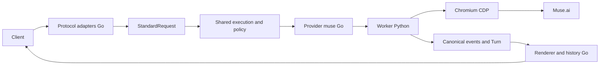

# Kế hoạch tích hợp Muse2API vào DS2API

Ngày khảo sát: 07/11/2026. Trạng thái: đề xuất triển khai; chưa thay đổi runtime.

Đề xuất thêm **provider `muse` trong Go**, kết nối tới **worker Python + Chromium/CDP** được quản lý trong cùng kho mã nguồn. DS2API tiếp tục xử lý API, chuẩn hóa yêu cầu, chính sách công cụ, lịch sử và usage; worker thực hiện thao tác với Muse.ai. Cách này tận dụng được hai nguồn Python và có đường triển khai cho cả máy chủ riêng lẫn Vercel.

## 1. Cơ sở khảo sát

| Nguồn | Snapshot đã đọc | Giá trị sử dụng | Giới hạn đã thấy |
| --- | --- | --- | --- |
| [www222fff/muse2api](https://github.com/www222fff/muse2api/tree/3a20b5e7aa4056c99c0eb8c732d73ce3804d5dbf) | `3a20b5e7aa4056c99c0eb8c732d73ce3804d5dbf` | Interface `MuseDriver`, dữ liệu chat/media, driver mock, phân lớp, pool và kiểm thử offline | Driver HTTP trực tiếp chưa triển khai chat/media; `/v1/responses` trả 501; README yêu cầu kiểm chứng browser driver bằng tài khoản thật |
| [czg86389-hub/muse2api](https://github.com/czg86389-hub/muse2api/tree/8a3dab9db13b23ac694d21af29e65504bc7e69b1) | `8a3dab9db13b23ac694d21af29e65504bc7e69b1` | `MuseEngine`, CDP, proxy HTTP/SOCKS5 theo tài khoản, tải media, kiểm chứng ảnh tham chiếu, session/VM và regression tests | Logic API/prompt/tools/tasks tập trung trong `app.py`; Responses chỉ hỗ trợ một phần; usage chat trả số 0; tool protocol mặc định tắt |
| DS2API hiện tại | `b5f2eba1c2dd2f5f9f3c4411fdd1a9d6d4705a91` | `StandardRequest`, `assistantturn`, `responsehistory`, pool/auth và các renderer | Chưa có provider Muse, route sinh ảnh/video hoặc runtime inference cho external provider |

Hai nguồn Muse2API đều có giấy phép MIT; GitHub đánh dấu `fork: false`. Tích hợp có chọn lọc theo snapshot, giữ giấy phép và thông tin tác giả cho phần mã sử dụng. Ghi xuất xứ và các sửa đổi trong `workers/muse/UPSTREAM.md` khi triển khai; không dựa vào chuỗi phiên bản vì metadata phiên bản giữa các file hiện chưa đồng nhất.

Các kết luận kỹ thuật được đối chiếu với mã nguồn, không chỉ README:

- [Interface driver của www222fff](https://github.com/www222fff/muse2api/blob/3a20b5e7aa4056c99c0eb8c732d73ce3804d5dbf/src/muse2api/drivers/base.py) tách thao tác upstream khỏi scheduling và OpenAI wire format; đây là mẫu cho hợp đồng worker.
- [Driver HTTP](https://github.com/www222fff/muse2api/blob/3a20b5e7aa4056c99c0eb8c732d73ce3804d5dbf/src/muse2api/drivers/http/driver.py) chưa có transport chat/media. HTTP đang dùng cho session/VM không đồng nghĩa với khả năng bỏ Chromium.
- [MuseEngine của czg86389-hub](https://github.com/czg86389-hub/muse2api/blob/8a3dab9db13b23ac694d21af29e65504bc7e69b1/engine.py) là ứng viên backend đầu tiên cho worker; kiểm chứng live trước khi chốt sử dụng.
- [API của czg86389-hub](https://github.com/czg86389-hub/muse2api/blob/8a3dab9db13b23ac694d21af29e65504bc7e69b1/app.py) ghi rõ model chat chỉ phục vụ tương thích, không chọn model ở Muse.ai. GPT/Claude/Gemini/Sora/Veo trong alias không chứng minh truy cập được các model đó.
- Quy tắc cookie khác nhau giữa hai nguồn. [Regression session-only import](https://github.com/czg86389-hub/muse2api/blob/8a3dab9db13b23ac694d21af29e65504bc7e69b1/tests/test_session_only_import.py) chấp nhận `hatch_sess`; trạng thái hoạt động phải được xác nhận bằng upstream, không suy ra từ việc import thành công.

Khảo sát lần này chỉ đọc source và metadata. Chưa chạy test suite của hai upstream hoặc thử tài khoản Muse.ai; những tuyên bố về tốc độ, quota và chất lượng cần đo ở giai đoạn 0.

## 2. Phạm vi sản phẩm

| Mốc | Khả năng đưa vào DS2API | Tiêu chí công bố |
| --- | --- | --- |
| Chat MVP | `muse-spark`, alias riêng `muse-chat`; chat stream/non-stream, Responses và tái sử dụng qua Claude/Gemini adapters | Cùng một standard request/turn, đúng key policy và lịch sử; không đi qua DeepSeek login/PoW |
| Images | `muse-image`; `/v1/images/generations`, `/v1/images/edits`; URL hoặc `b64_json` | Trả đúng media mới của lần sinh hiện tại; reference upload được xác nhận |
| Videos | `muse-video`; tạo tác vụ tại `/v1/videos`, polling `/v1/videos/{id}` và lấy kết quả | Tác vụ tồn tại qua restart; caller chỉ truy cập được tác vụ của mình |
| Mở rộng sau | Chat kèm ảnh, nhiều ảnh tham chiếu, image tasks, warm conversations, cookie extension | Bật từng capability sau kiểm thử; không gộp vào điều kiện hoàn thành chat MVP |

Model catalog phải phân biệt loại chat/image/video; dùng sai loại hoặc model không tồn tại phải báo lỗi. Chỉ thêm model Muse khi provider được cấu hình. Không nhập nguyên bảng alias upstream làm thay đổi routing DeepSeek/Gemini/Codex hiện có. Alias sang Muse phải được cấu hình rõ trong DS2API.

Function calling và reasoning là capability cần kiểm chứng. Ban đầu không quảng bá tools/reasoning/vision như năng lực đã xác nhận. Nếu thử tools, dùng injection và parser chung của DS2API, áp dụng `tools_enabled`, `tool_choice` và schema hiện hành. Không mang parser JSON riêng của `app.py` vào luồng nghiệp vụ; không tạo tool call hoặc reasoning giả để làm request thành công.

## 3. Kiến trúc đề xuất



### Phân công trách nhiệm

- **Go:** xác thực caller, kiểm tra model/account/quota/tools, chuẩn hóa messages, prompt-visible tool history, chính sách retry, chọn tài khoản, hoàn thiện turn, usage, lịch sử và render theo giao thức.
- **Worker:** lifecycle Chromium, context/tab riêng cho tài khoản, thao tác DOM/CDP, session/wake/quota probe, upload/download, timeout/cancel và lưu trạng thái tác vụ/media. Worker nhận tài khoản đã được Go chọn; không tự chuyển sang tài khoản ngoài phạm vi cho phép của caller.
- **Nguồn www222fff:** tham khảo/tái sử dụng hợp đồng driver, mock và các fixture về stream/cancel/session. **Nguồn czg86389-hub:** bọc phần engine/CDP/proxy đã chọn trong adapter thực thi; chuyển các regression tương ứng sang worker tests. Chỉ chạy một backend thật ở bản đầu.

Hợp đồng nội bộ có phiên bản: prompt đã chuẩn bị, `request_id`, account ID/revision, deadline và attachments; stream trả các event `text_delta`, `reasoning_delta` nếu có, `completed`, `error`. Metadata hoàn tất có account/thread ID thực tế, usage source và cookie updates. Không gửi toàn bộ pool hoặc API key của người dùng cho worker.

API worker dùng service credential riêng. Bản đầu giới hạn một tác vụ hoạt động trên một tài khoản; worker thực hiện khóa vật lý theo account để bảo vệ cả khi nhiều Go instance cùng gọi. Giới hạn tổng concurrency được đo ở giai đoạn 0. Cancellation phải dừng producer/CDP và giải phóng slot, không chỉ đóng kết nối HTTP.

### Những hành vi cần thống nhất

1. **Retry:** dùng điều kiện và giới hạn của lớp chung; retry empty-output chỉ trước khi đã gửi nội dung/tool call cho client, không retry content-filter/refusal như lỗi rỗng. Session/thread continuation là hook của Muse, không dùng DeepSeek `parent_message_id` hoặc PoW. Tắt vòng retry nghiệp vụ của gateway/app upstream khi bọc engine để tránh nhân số lần gọi.
2. **History:** một request tạo một lượt lịch sử/usage, kể cả retry. Mặc định mở/reset thread cho từng request và gửi đầy đủ ngữ cảnh. Warm tab không được giữ hội thoại của caller khác; conversation affinity chỉ thêm sau với khóa caller + conversation + account và kiểm chứng history prefix.
3. **Usage:** ưu tiên dữ liệu upstream đáng tin cậy; nếu thiếu, dùng bộ đếm chung với tokenizer fallback xác định và ghi rõ là ước lượng. Không coi các số 0 của upstream wrapper là usage chính xác. Phân biệt token quota của DS2API với quota ảnh/video/tuần của Muse.
4. **Files:** không chuyển DeepSeek file ID/token sang Muse. MVP giữ history đầy đủ trong prompt; `current_input_file` chỉ áp dụng khi Muse có capability upload tương ứng. File văn bản lấy được nội dung có thể đưa vào prompt qua xử lý chung; input chưa hỗ trợ phải báo lỗi rõ, không âm thầm bỏ attachment. Attachment types được bổ sung vào model chung khi triển khai images/vision.
5. **Prompt:** worker gửi đúng prompt nhận từ Go, không gọi lại `build_chat_prompt`, không sửa nội dung system và không inject tools lần thứ hai. Nếu Muse cần cách trình bày riêng, đặt renderer upstream cạnh provider và ghi lý do trong `docs/prompt-compatibility.md`.

`completionruntime` hiện giữ DeepSeek session/PoW và không phải runtime provider tổng quát. Tái sử dụng `assistantturn`, `promptcompat`, `responsehistory` và các chính sách thuần hiện có; trích orchestration cần thiết vào lớp chung nhỏ, với hook transport. Không đưa nhánh Muse riêng có nghiệp vụ lặp lại vào từng OpenAI/Claude/Gemini handler, và không gộp một cuộc refactor toàn bộ provider vào tính năng này.

## 4. Những vị trí mã nguồn cần thay đổi

| Vị trí hiện có hoặc đề xuất mới | Công việc |
| --- | --- |
| `internal/muse/` — mới | Client worker, model/capability mapping, errors, session hooks và runtime provider |
| `workers/muse/` — mới | RPC API, driver contract, mock, adapter engine/CDP/proxy, media/job store, tests, dependency lock và Dockerfile |
| [internal/config/config.go](../internal/config/config.go), [internal/config/account.go](../internal/config/account.go), [internal/config/models.go](../internal/config/models.go) | Muse config; cookie expiry/revision cần thiết; validation; model resolution và model catalog |
| [internal/auth/request.go](../internal/auth/request.go), [internal/auth/key_policy.go](../internal/auth/key_policy.go), `internal/account/` | Cookie auth cho Muse; không dùng DeepSeek token refresh; giữ account allowlist khi chọn/switch; giới hạn concurrency; từ chối direct DeepSeek-token fallback cho request Muse |
| `internal/promptcompat/`, `internal/assistantturn/`, `internal/completionruntime/`, `internal/responsehistory/` | Shared normalization/output/history; orchestration tối thiểu với provider hooks; capability handling cho files/tools/reasoning |
| `internal/httpapi/openai/chat/`, `internal/httpapi/openai/responses/`, `internal/httpapi/claude/`, `internal/httpapi/gemini/` | Gọi cùng runtime Muse sau chuẩn hóa và render bằng adapter; kiểm tra đường proxy/bridge và model listing |
| `internal/httpapi/openai/images/`, `internal/httpapi/openai/videos/` — mới; [internal/server/router.go](../internal/server/router.go) | Routes chat/media/tasks và dependency wiring; bổ sung shared media request/result thay vì nhét vào text completion |
| `internal/httpapi/admin/accounts/`, `internal/httpapi/admin/settings/` | Import/test/quota/cookie update theo provider; worker health và cấu hình kết nối |
| [webui/src/features/providers/ProvidersContainer.jsx](../webui/src/features/providers/ProvidersContainer.jsx), `webui/src/features/account/`, `webui/src/locales/` | Muse trong danh sách provider; account form/table và trạng thái session/proxy/quota; bản dịch vi/en/zh |
| [internal/js/chat-stream/index.js](../internal/js/chat-stream/index.js), [internal/js/chat-stream/proxy_go.js](../internal/js/chat-stream/proxy_go.js), [vercel.json](../vercel.json) | Muse stream đi qua Go; giải quyết alias bằng resolver Go; route admin/media và thời hạn request |
| `.env.example`, `config.example.json`, `docker-compose.yml`, docs và CI/scripts | Cấu hình mẫu; worker service tùy chọn; volume; Python gates; tài liệu vận hành |

`internal/extprovider/` hiện dùng cho CRUD/discovery/inspection qua admin. Nó chưa được gọi bởi runtime chat, chưa được gắn vào `ResolveModelTarget` hay public model catalog. Có thể tái sử dụng trải nghiệm quản lý provider, nhưng chỉ thêm Base URL ở màn hình này chưa tạo được tích hợp. Không biến việc bổ sung Muse thành tính năng inference tổng quát cho mọi external provider.

### Tài khoản và trạng thái

- Tái sử dụng account DS2API với `provider: "muse"`, identifier ổn định, cookies và proxy reference. Import chấp nhận `hatch_sess`, giữ metadata các cookie khác nếu có; probe upstream mới xác nhận session. Không tự cộng thêm 48 giờ sau lần kiểm tra thành công.
- Go là nguồn cấu hình và access policy. Worker quản lý cache session/CDP gắn account revision; trả cookie được upstream cấp lại để Go cập nhật store. Cookie/proxy thay đổi phải hủy cache cũ sau khi tác vụ đang chạy kết thúc.
- Với Vercel cấu hình từ environment, runtime cookie cache của worker cần lưu bền vững và gắn credential revision để cấu hình khởi tạo cũ không ghi đè cookie mới. Không dùng `/tmp` làm nguồn lưu duy nhất. Import/config thay đổi phải dùng cơ chế writeback được hỗ trợ hoặc cập nhật cấu hình triển khai.
- Tách lỗi proxy/network, session auth, quota, VM chưa `RUNNING`, model refusal và browser failure. Proxy lỗi không tự chuyển sang mạng trực tiếp, và không bị ghi nhầm thành cookie hết hạn. Các trạng thái này cần có test tương ứng.

## 5. Đường triển khai và Vercel

| Môi trường | Go/API | Worker và dữ liệu |
| --- | --- | --- |
| Windows/VPS | Binary Go hiện tại | Python/Chromium trên máy chủ; service riêng; CDP chỉ truy cập nội bộ |
| Docker | Container DS2API | Worker service tùy chọn, network nội bộ, volume session/job/media; không bắt mọi deployment phải cài Chromium |
| Vercel | Go function và Node stream entry hiện có | Worker từ xa trên VPS/container; job/session/media lưu bền vững ở worker hoặc object storage |

Vercel hiện đặt `maxDuration: 300` cho Go và Node. Không đặt tác vụ video dài trong request function hoặc background goroutine của Go function. Tạo job ở worker, trả ID nhanh và polling; việc worker xử lý tiếp không phụ thuộc tuổi thọ function.

Node entry hiện chuyển Codex về Go nhưng dùng luồng DeepSeek cho các stream chat còn lại. Muse cần được phân tuyến về Go **trước** bước DeepSeek prepare/PoW, bao gồm cả model alias và header chọn provider. Quyết định chính thức lấy từ Go model resolver; không chỉ thêm một danh sách prefix hardcode ở Node. Kiểm thử default rewrite, `__go` và cancellation để tránh proxy loop hoặc xử lý hai lần.

Ảnh đồng bộ trên Vercel phải có deadline nhỏ hơn giới hạn function; nếu cần thời gian dài, cung cấp image task extension riêng và mô tả rõ API. Polling/media/admin cần route tới Go trước fallback SPA. URL media dùng public base đúng deployment và cơ chế truy cập có thời hạn; không trả URL localhost hay tên file nội bộ cho client.

Task ID và media phải gắn caller ownership. Worker lưu mapping bền vững, idempotency key và trạng thái `queued/running/completed/failed/interrupted`; submit lặp sau timeout không sinh thêm video. Retry chat không áp dụng tự động cho media generation. Reference fetch/download giữ kiểm tra kích thước, MIME, nguồn, redirect và DNS như các regression upstream đã có.

## 6. Thứ tự triển khai

Ước lượng dưới đây là ngày công cho một người, có tài khoản thử và worker host sẵn; chưa tính thời gian chờ xử lý biến động upstream.

| Giai đoạn | Ước lượng | Deliverable và điều kiện chuyển mốc |
| --- | --- | --- |
| 0 — Kiểm chứng và chốt contract | 1–2 ngày | Pin hai SHA; chạy fixture tests chọn lọc; thử chat/session/proxy trên MuseEngine; đo first token, memory/concurrency; chốt driver, contract, cookie requirements và capability matrix |
| 1 — Worker + provider + chat | 4–6 ngày | Worker mock/real; config/account/auth; shared runtime; chat stream/non-stream; Responses; Claude/Gemini parity; cancellation; lịch sử/usage đúng một lần. Sẵn sàng chat MVP trên máy chủ riêng |
| 2 — Vận hành và Vercel chat | 2–3 ngày | Docker/Windows instructions; remote worker; Node→Go routing gồm alias; worker health; UI account/provider tối thiểu; triển khai Vercel chat thử và kiểm chứng deadline |
| 3 — Images | 3–4 ngày | Shared media model; generation/edit; reference upload confirmation; đúng media mới; ownership/URL/b64; tests và đường Vercel tương ứng |
| 4 — Videos và hoàn thiện | 3–5 ngày | Durable jobs/polling/idempotency; reference frame và duration thực tế; restart/cancel; media lifecycle; admin tối thiểu; full gates và docs |

Tổng dự kiến **13–20 ngày công**, khoảng **3–4 tuần**; chat MVP khoảng **5–8 ngày công**. Mỗi giai đoạn là một PR có thể review riêng; nếu một giai đoạn lớn, tách worker contract và Go wiring nhưng chỉ công bố capability khi đã nối hoàn chỉnh.

Giai đoạn 0 thất bại live thì ghi lỗi/fixture và sửa driver trước khi mở mốc sản phẩm. Browser mock pass không được dùng thay bằng chứng upstream hoạt động. Warm conversations, import extension và image tasks là các PR sau, trừ khi được chọn làm yêu cầu phát hành.

## 7. Kiểm thử và tài liệu

### Kiểm thử cần có khi triển khai

- **Go contract/routing:** model loại đúng/sai, alias không đổi provider khác, provider thiếu/tắt, Muse không bị DeepSeek login/PoW; worker unreachable/auth error/timeout và stream lỗi sau khi đã gửi một phần.
- **Access policy:** DS2API key hợp lệ; account allowlist giữ nguyên cả lúc retry; model whitelist/token quota; tools tắt/none/required; không chuyển caller credential cho worker; task/media ownership.
- **Shared semantics:** cùng fixture ở Chat/Responses/Claude/Gemini cho text, reasoning nếu có, EPSE tool calls, tool history, empty-output, refusal, Unicode, đoạn SSE dài và attachment chưa hỗ trợ; stream/non-stream có cùng kết quả cuối.
- **Worker/CDP:** cookie isolation giữa account/caller, một account dùng đồng thời ở nhiều Go instance, proxy đổi/xuất lỗi, session-only import, cookie expiry thực, wake xác nhận `RUNNING`, quota gắn đúng account; cancel giải phóng tab/lock.
- **Media:** reference upload thất bại; không trả ảnh input/preview/historical attachment; media đến muộn; MIME/kích thước/redirect; job restart và submit lặp; duration thực tế khác duration yêu cầu.
- **Vercel:** Muse explicit/alias/header qua Node→Go; mọi protocol entry; deadline/cancel; không phụ thuộc filesystem tạm hoặc background function; URL và polling vẫn hoạt động sau khi request kết thúc.
- **Regression:** DeepSeek/Gemini/Codex, auth/history/files và existing Node stream suite tiếp tục qua gates. Live tests dùng tài khoản thử, tách khỏi CI offline.

CI hiện chỉ chạy Go/Node, chưa bao phủ worker Python. Bổ sung Python lint/fixture tests và wiring vào unit gate/CI cùng PR đưa worker vào; khóa dependency để kết quả có thể tái tạo. Các test upstream phụ thuộc `app.py` phải chuyển sang wrapper/fixture phù hợp, không nhập toàn upstream app để test worker.

Trước mỗi PR, chạy các lệnh bắt buộc trong AGENTS.md:

```powershell
& "C:\Program Files\Git\bin\bash.exe" -c "./scripts/lint.sh"
& "C:\Program Files\Git\bin\bash.exe" -c "./tests/scripts/check-refactor-line-gate.sh"
& "C:\Program Files\Git\bin\bash.exe" -c "./tests/scripts/run-unit-all.sh"
npm run build --prefix webui
```

Chạy `gofmt -w` cho Go files thay đổi; xử lý hoặc log lỗi cleanup I/O. Giữ file mới theo module nhỏ; line gate hiện áp dụng danh sách `plans/refactor-line-gate-targets.txt`, nên cập nhật danh sách cho phần code sở hữu mới phù hợp thay vì bỏ qua bằng cách dồn logic vào một file.

Tài liệu cập nhật cùng implementation: `docs/prompt-compatibility.md` cho normalized path, prompt/tools/files/retry/usage; `docs/ARCHITECTURE*.md` cho worker/provider boundary; `API*.md` cho model/media/tasks/errors; `docs/DEPLOY*.md` và hướng dẫn tiếng Việt cho Chromium, remote worker, Vercel, volume và vận hành. Tài liệu hiện tại chỉ là kế hoạch, không thay source-of-truth thành hành vi chưa triển khai.

## 8. Lựa chọn kiến trúc khác

| Hướng | Đánh giá |
| --- | --- |
| Provider Go + worker Python/CDP trong cùng repo — đề xuất | Tận dụng engine hiện có, giữ nghiệp vụ ở DS2API, hỗ trợ remote worker trên Vercel; có thêm thành phần vận hành |
| Chỉ proxy nguyên OpenAI API của Muse2API | Hữu ích cho thử kết nối, nhưng chưa đáp ứng shared policy/history/usage của dự án; extprovider hiện cũng chưa có inference routing |
| Port toàn bộ CDP/engine sang Go | Phù hợp nếu mục tiêu sau này là bỏ Python; phạm vi lớn và vẫn cần Chromium. Đánh giá lại sau fixture/live coverage, không giả định HTTP driver đã sẵn có |

Chốt mặc định cho kế hoạch: một provider Muse, một worker backend thật, chat trước rồi ảnh/video; dùng Go làm nơi xử lý nghiệp vụ chung. Nếu yêu cầu triển khai bắt buộc chỉ có Go, cần thay kiến trúc worker bằng Go CDP adapter và ước lượng lại sau giai đoạn 0.
